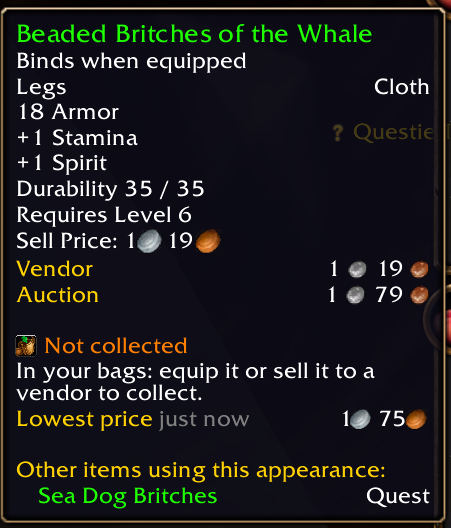
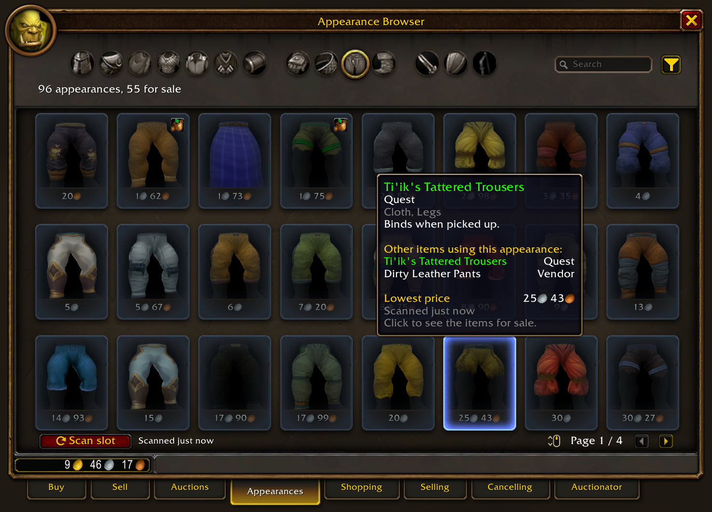
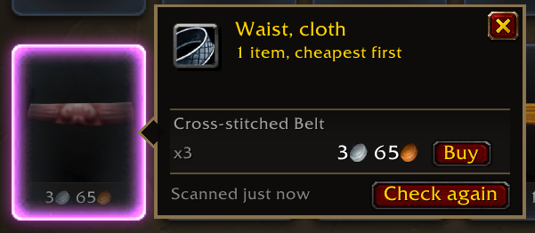
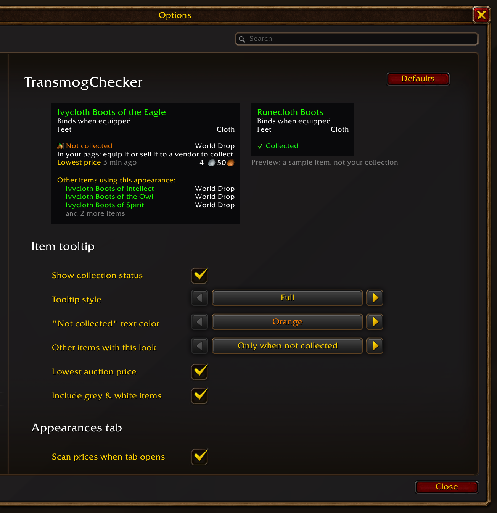

# TransmogChecker

TransmogChecker tells you which appearances you have collected, on item tooltips and in an Appearances tab on the auction house window. It is made for the **WoW: Forever** client (`## Interface: 16001`).

An item tooltip in the Full style.

## What it does

### Item tooltips

Hover an item and TransmogChecker adds whether its appearance is collected, in one of two styles:

- **Full**: lines under the game's own: "Collected" or "Not collected" with how the item is obtained, a note for items that bind when equipped, the lowest auction price the Appearances tab has seen this session, and the other items that carry the same appearance (up to four, else three and "and N more items").
- **Compact**: "Collected" or "Not collected" on the right of the item's name line, with the number of other items.

When an item you bought or have in your bags would add a look you do not have yet, the tooltip says how to collect it (equip it, or sell it to a vendor). The game's own "not collected" line is hidden while TransmogChecker's lines show. Grey and white items get no lines unless you turn that on.

The Appearances tab on the auction house window.

### The Appearances tab

Open the auction house and pick the **Appearances** tab (the window's title then reads Appearance Browser). It shows every appearance of one slot as tiles, like the game's Collections window, and tells you which are for sale.

- Pick a slot in the slot row: Head, Shoulder, Back, Chest, Shirt, Tabard, Wrist, Hands, Waist, Legs, Feet, Main hand, Off hand, Ranged.
- **Scan slot** reads the auction house for that slot and puts the lowest price on each tile for sale. By default the slot is scanned when the tab opens.
- Click a tile to check the auction house for that one appearance; click it again to see the items for sale, cheapest first, under the cheapest item's icon, each with a **Buy** button. Buy opens a small dialog that finds the cheapest auction and buys it at its buyout.
- The **Filter** button holds: Show (All, Collected, Not collected, and Bought, not collected while something you bought or have in your bags would add a look), For sale only, Source (only the source types the game reports for the looks of the selected slot, so a type with nothing in that slot is not listed), Class (All classes, your class or another class), Sort (Collections order, Price: low to high, Price: high to low) and Scan prices when the tab opens, then Reset filters while a filter or the sort differs from the start, and Settings…. Weapon slots also have a weapon type dropdown. Armor slots have an armor type dropdown (All armor types, then each type your chosen class can wear), one choice for every armor slot, kept between sessions. The Search box narrows by item name.
- The tab starts on Not collected, sorted Price: low to high, with the class filter on your own class. Your Show, For sale only, sort, slot and All classes choices are kept between sessions.

A tile's list of items for sale.

### Settings

Options > AddOns > TransmogChecker. The page starts with a preview of the tooltip, then:

- **Item tooltip**: Show collection status; Tooltip style (Full, Compact); "Not collected" text color (Orange, Light blue, White); Other items with this look (Only when not collected, Always, Never); Lowest auction price (Full style only); Include grey & white items.
- **Appearances tab**: Scan prices when tab opens.

The settings page.

### Languages

TransmogChecker is available in English, German, French, Italian, Spanish (EU and Latin America), Portuguese (Brazil), Russian, Korean, Simplified Chinese and Traditional Chinese. It follows the game's language; the Language setting on the settings page overrides it, and a change applies after the interface reloads. The translations are new, and corrections are welcome.

## Slash commands

- `/tc` opens the settings page.
- `/tc help` lists the commands.
- `/tc debug` turns debug output on or off.

`/tc alts` and `/tc skipgreys` remain as shortcuts for Other items with this look and Include grey & white items. You can also open the settings from the addon list on the minimap.

## Install

Install it with the CurseForge app, or download the zip from CurseForge and put the `TransmogChecker` folder into `World of Warcraft\_forever_\Interface\AddOns`. Then restart the game or type `/reload`.

## Known limits

- Opening the settings page closes the auction house window, because the game's Options window does.
- The Source filter lists only the source types the game reports for the looks of the selected slot, so a type with nothing in that slot is not listed.
- Prices are what the last scan or check saw. The lowest price on tooltips is kept for the session only and is gone after a reload or logout.
- In combat the settings page opens after combat ends.
- Only WoW: Forever is supported. Releases up to 0.0.21 were for Mists of Pandaria Classic and get no new work.

## Problems

Report a problem on the [GitHub issues page](https://github.com/DelaneDiamon/Transmog-Checker/issues).
